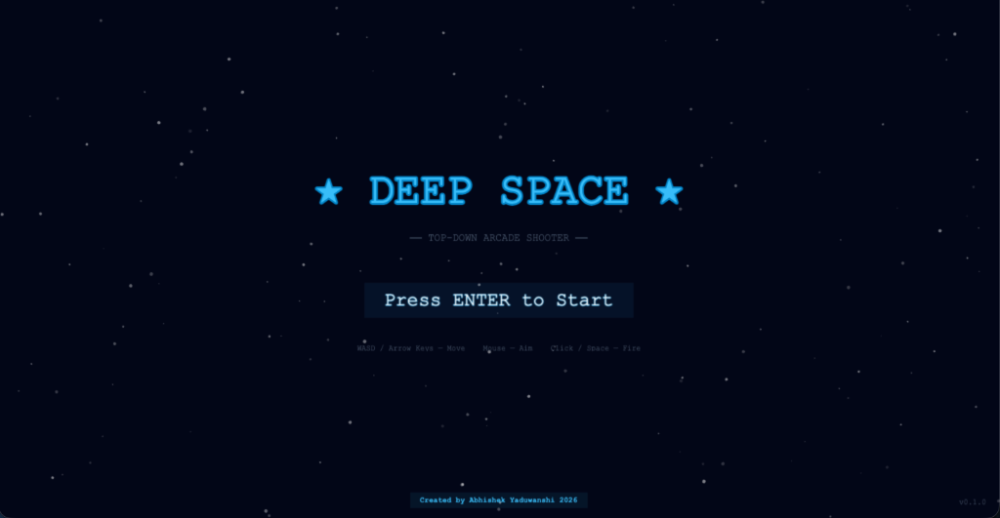
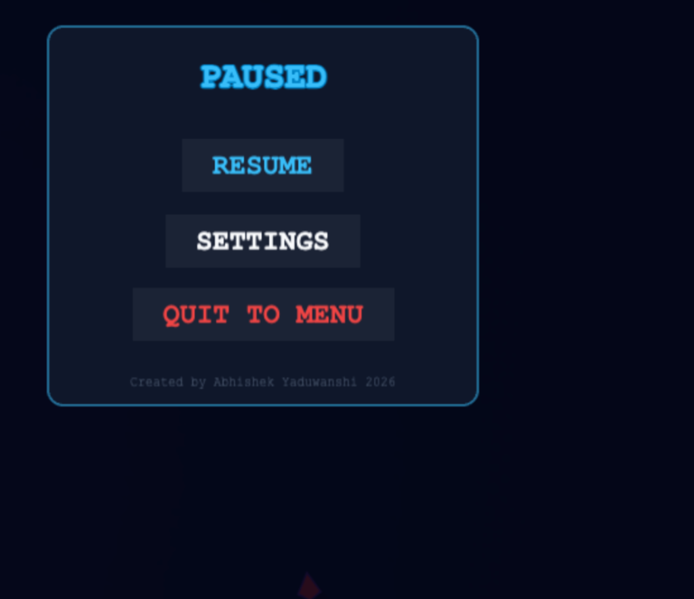

# Multimedia Systems Lab — Lab Test 2
## Problem Statement: Develop a Customizable 2D Arcade Game

**Student Name:** Abhishek Yaduwanshi  
**Course:** Multimedia Systems Lab  
**Evaluation:** Lab Test 2  
**Project Title:** Deep Space — 2D Top-Down Customizable Arcade Game  
**Academic Year:** 2026  
**Watermark:** Created by Abhishek Yaduwanshi 2026  
**Live Game URL:** [https://deep-space-mm-lab-test.vercel.app/](https://deep-space-mm-lab-test.vercel.app/)

[](https://deep-space-mm-lab-test.vercel.app/)
[](https://github.com/Abhishek4852/deep-space-MM-Lab-Test)  

---

## 📸 Screenshots Gallery

| Screen | Preview |
| :--- | :--- |
| **Start / Home Screen** |  |
| **Gameplay & In-Game Menu** |  |
| **Custom Player Starship** |  |

---

## 🎯 1. Objective

The objective of this project is to design, engineer, and evaluate an interactive 2D arcade game demonstrating the end-to-end integration of multimedia components:
- Vector/sprite visual animation and particle physics
- Real-time procedural audio synthesis using the Web Audio API
- Responsive event handling across both desktop keyboards/mice and mobile multi-touch devices
- Collision detection algorithms and mathematical state updates
- Dynamic difficulty scaling and comprehensive game state management

Each student is required to implement an individually customized version of the game that introduces unique mechanics, graphics, audio, and gameplay behavior beyond a standard template.

---

## 🕹️ 2. Game Description

**Deep Space** is an action-packed 2D top-down space arcade survival game. The player pilots a customized starship navigating deep cosmos sectors, engaging hostile alien formations, collecting energy canisters, repair nanites, and weapon power-ups, while dodging hazardous asteroids, plasma mines, and enemy projectiles.

### Core Gameplay Flow:
```
  [ Start Screen / Main Menu ]
             ↓ (Click "Start Mission" or Press Enter)
  [ Active Gameplay: Sector 1 ]
             ↓
  • Pilot ship & aim weapons
  • Collect Power-ups (Shield, Health, Speed, Blaster)
  • Destroy Enemy Formations (Swarm, Sniper, Bomber, Elite, Boss)
  • Score points & build combo multipliers
             ↓
  [ Pause State (ESC / Pause Button) ] ⇄ [ Resume / Settings / Audio Toggle ]
             ↓
  [ Waves Scale Difficulty & Introduce Boss Battles ]
             ↓
  Player HP Reaches 0
             ↓
  [ Game Over Screen ] → [ 🔄 Instant Restart (No Browser Refresh) ]
```

---

## ⚙️ 3. Functional Requirements Fulfilled

| Requirement | Implementation in Deep Space |
| :--- | :--- |
| **Game Interface** | High-definition animated title screen, in-game HUD (Dynamic HP bar, Shield bar, Wave indicator, Score display, Active Weapon Card, Interactive Weapon Tabs), Pause Menu, Settings Modal, and Game Over Screen. |
| **Player Controls** | **Desktop**: WASD / Arrow keys for movement, Mouse for 360° aiming, Left-click / Spacebar for firing, `1`-`5` / `Q` / `E` / Scroll Wheel for weapon switching.<br>**Mobile / Touch**: Virtual analogue joystick (left thumb), tactile Fire Button (right thumb), and dedicated on-screen `[ 🔄 SWITCH ]` weapon tabs. |
| **Animation** | 60 FPS continuous animation loop, parallax multi-layered scrolling starfield, animated celestial nebulae, drifting comets with light tails, pulsing engine thruster flame, dynamic shield aura, bullet tracers, and particle explosions. |
| **Collision Detection** | Mathematical Radial Distance (Circle-to-Circle) and Axis-Aligned Bounding Box (AABB) checks for: (1) Player vs. Collectibles, (2) Player vs. Enemies/Hazards, (3) Player Projectiles vs. Enemies, (4) Enemy Projectiles vs. Player, and (5) Lightning Chain-Arc branching. |
| **Scoring & Combo** | Dynamic score counter rewarding enemy destructions scaled by tier, accuracy combos, wave completion bonuses, and boss takedown rewards. |
| **Difficulty Scaling** | Wave progression engine (`WaveSystem.ts`): increases enemy spawn rates, movement speeds, projectile fire rates, introduces advanced enemy AI types, and triggers epic Boss encounters every few waves. |
| **Game States** | Clean finite state machine: `BOOT` → `PRELOAD` → `MENU` → `PLAYING` ⇄ `PAUSED` → `GAME_OVER`. |
| **Multimedia Integration** | Dual-channel multimedia system: high-definition visual assets (vector-rendered ships, custom particles, glowing laser beams) + built-in procedural Web Audio synthesizer (`AudioManager.ts`). |
| **Customization** | Custom 5-weapon arsenal with active switching, procedural Web Audio sound synthesizer, dynamic mobile touch screen-space hit testing, and high-DPI sci-fi typography. |
| **Restart Mechanism** | Instant in-memory reset through `[ 🔄 RESTART MISSION ]` button or `ENTER` key without reloading the web page. |

---

## 🌟 4. Individual Customization Details (Abhishek Yaduwanshi)

For this laboratory test, the following distinct customizations have been engineered and demonstrated:

### A. 5-Tier Advanced Weapon Arsenal with In-Game Hot-Swapping
The player can dynamically switch between five unique weapons, each having different visual sprites, firing rates, damage calculations, and ballistic behaviors:
1. **Blaster (`BlasterWeapon.ts`)**: Rapid-fire twin plasma cannon with low energy consumption.
2. **Plasma Shotgun (`ShotgunWeapon.ts`)**: 5-round angular spread weapon designed for close-quarters crowd control.
3. **Homing Missiles (`MissileWeapon.ts`)**: Autonomous target-seeking explosive ordnance with dynamic steering vectors toward the closest hostile entity.
4. **Laser Beam (`LaserBeamWeapon.ts`)**: High-intensity penetrating coherent energy beam that pierces through multiple enemies simultaneously.
5. **Lightning Arc (`LightningWeapon.ts`)**: Electro-magnetic pulse weapon that discharges chain lightning jumping between nearby enemy hulls.

### B. Procedural Web Audio Synthesizer (`AudioManager.ts`)
In accordance with lab test constraints requiring local/self-created assets with zero external downloads:
- Custom frequency-modulated (FM) audio synthesis using native HTML5 `AudioContext`.
- Real-time synthesized sound effects:
  - High-frequency laser chirps
  - Shotgun burst pops
  - Rocket thruster whistling
  - Continuous laser harmonics
  - Electrical lightning zaps
  - Deep sub-bass explosion rumble
  - Ambient deep-space cosmic drone with oscillating filter cutoff.

### C. Screen-Space Independent UI & Multi-Device Responsive Input
- Custom screen-space pointer hit detection (`handleScreenPointerDown`) completely decoupling UI interaction from world camera movement.
- Full multi-touch support for iOS Safari and Android Chrome alongside desktop keyboard/mouse setups.

---

## 🧮 5. Algorithm & Collision Detection Logic

### 1. Game Update Loop (Phaser 60 FPS Cycle)
At every frame update $t$, delta time $\Delta t$ is calculated:
1. **Input Polling**: Reads directional vector $\vec{V}_{input} = (v_x, v_y)$ from either keyboard keys or the virtual joystick displacement vector.
2. **Kinematic Updates**:
   $$\vec{P}_{player}(t + \Delta t) = \vec{P}_{player}(t) + \vec{V}_{input} \cdot S_{player} \cdot \Delta t$$
   Velocity is damped with friction to simulate inertial space navigation.
3. **Weapon Cooldown & Aiming**:
   $$\theta = \text{atan2}(y_{pointer} - y_{player}, x_{pointer} - x_{player})$$
4. **AI Behavior Trees**: Enemies calculate navigation vectors according to their archetype (Chase, Swarm, Sniper, Orbit, Bomber, Charge).

### 2. Collision Detection Implementation
The project combines two primary collision techniques:

#### A. Radial (Circle-to-Circle) Distance Detection
Used for fast circular entities such as bullets, missiles, energy power-ups, and spherical space dust:
$$\text{Distance}^2 = (x_2 - x_1)^2 + (y_2 - y_1)^2$$
$$\text{Collision occurs if } \text{Distance}^2 \le (R_1 + R_2)^2$$
*Optimization*: Calculation avoids the costly square-root operation ($\sqrt{}$) by comparing squared Euclidean distances directly.

#### B. Axis-Aligned Bounding Box (AABB) Separating Axis Detection
Used for non-spherical large entities, boss hitboxes, and screen boundaries:
$$\text{Collision} = (A.x_{min} \le B.x_{max}) \land (A.x_{max} \ge B.x_{min}) \land (A.y_{min} \le B.y_{max}) \land (A.y_{max} \ge B.y_{min})$$

#### C. Homing Missile Steering Algorithm
Homing missiles scan for the nearest active enemy within range $R_{seek}$:
$$\vec{D} = \vec{P}_{enemy} - \vec{P}_{missile}$$
$$\theta_{target} = \text{atan2}(D_y, D_x)$$
$$\theta_{new} = \theta_{current} + \text{clamp}(\theta_{target} - \theta_{current}, -\omega_{max} \cdot \Delta t, +\omega_{max} \cdot \Delta t)$$

#### D. Lightning Arc Chain Algorithm
Upon impact, the lightning projectile queries the `EnemySystem` spatial array for the $K$-nearest neighbor targets within chain radius $R_{chain} = 220\text{px}$, generating dynamic connecting lightning graphics and applying cascading damage.

---

## 🛠️ 6. Technical Stack & Constraints

- **Language / Framework**: TypeScript 6.0 + Phaser 3/4 + HTML5 Canvas
- **Bundler**: Vite 8.1
- **Audio Architecture**: Native Web Audio API (`AudioContext`, `OscillatorNode`, `GainNode`, `BiquadFilterNode`)
- **Graphics Pipeline**: Procedural Canvas 2D / WebGL rendering with antialiasing and subpixel smoothing
- **Typography**: Google Web Fonts (*Orbitron*, *Rajdhani*)
- **Compliance**:
  - No external commercial game engines, no black-box generative AI models at runtime.
  - 100% locally executed source code with modular architecture.
  - Fully explainable data structures and algorithms.

---

## 🚀 7. Execution Instructions

### 🌐 Instant Live Playable Demo (No Installation Required)
Directly test and evaluate the game live on Vercel (Desktop & Mobile touch compatible):  
👉 **[https://deep-space-mm-lab-test.vercel.app/](https://deep-space-mm-lab-test.vercel.app/)**

### Local Setup Prerequisites
- Node.js (version 18.x or newer recommended)
- npm (Node Package Manager)

### Installation & Execution Steps

1. **Clone the repository:**
   ```bash
   git clone https://github.com/Abhishek4852/deep-space-MM-Lab-Test.git
   cd deep-space-MM-Lab-Test
   ```

2. **Install project dependencies:**
   ```bash
   npm install
   ```

3. **Start local development server:**
   ```bash
   npm run dev
   ```
   Open the displayed URL (usually `http://localhost:5173/`) in Google Chrome, Safari, or Microsoft Edge.

4. **Production Build & Verification:**
   ```bash
   npm run build
   npm run preview
   ```

---

## 🎮 8. Controls Reference

| Action | Desktop Controls | Mobile / Touch Controls |
| :--- | :--- | :--- |
| **Move Starship** | `W, A, S, D` or `Arrow Keys` | Left Virtual Joystick |
| **Aim Weapon** | Mouse cursor position | Auto-aims towards movement vector |
| **Fire Active Weapon** | Left Mouse Click or `Spacebar` | Right Virtual Fire Button |
| **Switch Weapon** | `1`, `2`, `3`, `4`, `5` or `Q` / `E` / Scroll Wheel | On-screen `[ 🔄 SWITCH ]` button or direct Weapon Tabs |
| **Pause / Resume** | `ESC` Key | On-screen Pause icon `[ ⏸️ ]` |
| **Restart Game** | `ENTER` Key | `[ 🔄 RESTART MISSION ]` on Game Over screen |

---

## 📁 9. Repository Structure

```
deep-space-MM-Lab-Test/
├── index.html                   # HTML5 Entry Point with high-DPI viewport & sci-fi fonts
├── package.json                 # Project dependencies and build scripts
├── tsconfig.json                # Strict TypeScript configuration
├── vite.config.ts               # Vite build configuration
├── screenshots/                 # Application screenshots for evaluation
│   ├── home_screen.png          # Main menu and title screen
│   ├── gameplay_and_pause.png   # Active gameplay HUD and pause overlay
│   └── player_starship.png      # Starship visual asset
├── src/
│   ├── main.ts                  # Phaser Game instantiation
│   ├── audio/
│   │   └── AudioManager.ts      # Procedural Web Audio API sound engine
│   ├── config/
│   │   ├── gameConfig.ts        # Canvas resolution, WebGL antialiasing, scale settings
│   │   ├── EnemyConfig.ts       # Enemy archetype stat definitions
│   │   └── WaveConfig.ts        # Dynamic wave scaling curves
│   ├── core/
│   │   ├── AssetKeys.ts         # Central asset registry
│   │   └── SceneKeys.ts         # Scene navigation identifiers
│   ├── entities/
│   │   ├── Player.ts            # Player starship entity & movement
│   │   ├── Bullet.ts            # Projectile entity with piercing & chain hooks
│   │   └── PowerUp.ts           # Collectible energy/shield items
│   ├── enemies/
│   │   ├── Enemy.ts             # Base enemy class
│   │   ├── EnemySpawner.ts      # Spatial wave spawning logic
│   │   └── ai/                  # Distinct AI behaviors (Chase, Swarm, Sniper, Bomber)
│   ├── weapons/
│   │   ├── BaseWeapon.ts        # Abstract weapon base class
│   │   ├── BlasterWeapon.ts     # Rapid auto-cannon
│   │   ├── ShotgunWeapon.ts     # Multi-projectile spread weapon
│   │   ├── MissileWeapon.ts     # Target-seeking ordnance
│   │   ├── LaserBeamWeapon.ts   # Continuous piercing ray
│   │   ├── LightningWeapon.ts   # EMP chain reaction weapon
│   │   └── WeaponType.ts        # Weapon registry metadata
│   ├── scenes/
│   │   ├── BootScene.ts         # Boot lifecycle
│   │   ├── PreloadScene.ts      # Procedural texture baking
│   │   ├── MenuScene.ts         # Dynamic animated home screen & arsenal modal
│   │   └── GameScene.ts         # Core gameplay orchestration
│   ├── systems/
│   │   ├── WeaponSystem.ts      # Multi-weapon manager & cycling
│   │   ├── CollisionSystem.ts   # Mathematical hit detection & AOE
│   │   ├── EnemySystem.ts       # Enemy pool & AI update loop
│   │   ├── WaveSystem.ts        # Difficulty scaling waves
│   │   └── BossSystem.ts        # Boss battle lifecycle & health bars
│   └── ui/
│       ├── PauseMenu.ts         # Screen-space responsive pause modal
│       ├── GameOverOverlay.ts   # Screen-space restart overlay
│       ├── SettingsOverlay.ts   # Audio & HUD settings modal
│       └── HUD/                 # Real-time health, shield, weapon status
```

---

## 🏆 10. Expected Learning Outcomes Demonstrated

1. **Multimedia Integration**: Seamless real-time coordination between 2D animated graphics, particle effects, and procedural synthesized audio.
2. **Interactive Event Handling**: Multi-platform input processing reconciling continuous mouse coordinates, keyboard keystrokes, and discrete mobile touch events.
3. **Collision Detection & Physics**: Practical implementation of Euclidean distance checks and bounding boxes for real-time interactive game mechanics.
4. **State Machine Design**: Robust architecture isolating game states (`Menu`, `Gameplay`, `Pause`, `Game Over`) ensuring smooth transitions and instant replayability without memory leaks.
5. **Software Engineering**: Clean modular code organization in TypeScript, adhering to OOP principles, separation of concerns, and reproducible build systems.

---

**Developed & Submitted By:**  
**Abhishek Yaduwanshi**  
*Multimedia Systems Lab — 2026*
